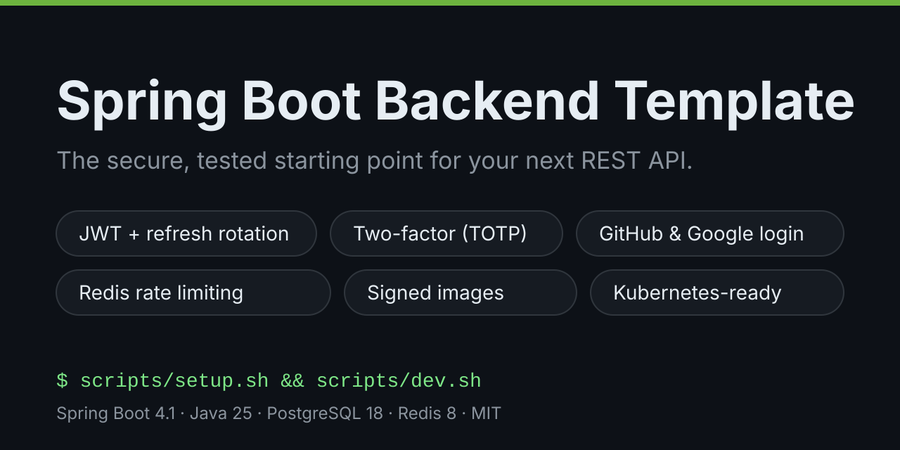

# Spring Boot Backend Template



[](https://github.com/hikmethankolay/spring-boot-backend-template/actions/workflows/ci.yml)
[](https://hikmethankolay.github.io/spring-boot-backend-template/coverage/)
[](https://github.com/hikmethankolay/spring-boot-backend-template/actions/workflows/mutation.yml)
[](https://scorecard.dev/viewer/?uri=github.com/hikmethankolay/spring-boot-backend-template)
[](https://github.com/hikmethankolay/spring-boot-backend-template/releases)
[](LICENSE)

Start a new Spring Boot REST backend from a codebase that already handles the hard, repetitive parts:
secure login, user accounts, errors, caching, monitoring and deployment. All of it is tested and documented.

**[Read the documentation →](https://hikmethankolay.github.io/spring-boot-backend-template/)**

[](https://codespaces.new/hikmethankolay/spring-boot-backend-template)



## Why use it

- **Authentication you don't have to write.** Short-lived JWTs with rotating refresh tokens and reuse detection,
  logout that really revokes, every session ended on a password change, email verification, password reset,
  two-factor authentication with authenticator apps, login with GitHub and Google, brute-force lockout, rate
  limiting, security headers and an audit log.
- **A worked example to copy.** The sample `note/` feature shows ownership checks, pagination, migrations, the data
  export and tests in a few small files, and `scripts/client.sh` gives your frontend typed API calls.
- **Production defaults out of the box.** One `prod` profile switches on JSON logs, secure cookies, required email
  verification and an internal metrics port. Migrations, Redis caching, an email outbox with retries, query timeouts,
  metrics with alert rules and a Grafana dashboard, tracing, account deletion and data export are already wired in.
- **Tested against the real thing.** 190+ tests run against real PostgreSQL and Redis containers, alongside architecture
  rules, a load test and a vulnerability scan of the Docker image in CI.
- **Ready to ship.** Releases publish signed multi-arch images with an SBOM; Kubernetes manifests pass the
  `restricted` Pod Security Standard.
- **One command per task** on Linux, macOS and Windows: setup, dev, test, build, run, docker, docs and more.

Built with Spring Boot 4.1, Java 25, PostgreSQL 18 and Redis 8.

### Why the newest versions

A template is copied once and then lives for years, so it starts on the newest releases: every project created from
it begins with the longest support window ahead instead of a migration. Java 25 is an LTS release; Spring Boot 4.1,
PostgreSQL 18 and Redis 8 are the current major versions. Dependabot proposes updates weekly.

### Compatibility

| Component | Used and tested | Oldest expected to work | Notes |
|-----------|-----------------|-------------------------|-------|
| JDK | 25 | 25 | Enforced by the build (Maven Enforcer) |
| Maven | 3.9.16 (wrapper) | 3.9 | Use `./mvnw` |
| Spring Boot | 4.1 | 4.1 | Spring Framework 7, Spring Security 7, Jakarta EE 11 |
| PostgreSQL | 18 | 15 | Plain SQL migrations; only 18 runs in CI |
| Redis | 8 | 7 | Plain commands and Lua scripts; only 8 runs in CI |
| Kubernetes | not run in CI | 1.25 | Stable APIs only; Pod Security admission is GA since 1.25 |

Policy: patch and minor updates land as soon as the tests pass. A new major version of a component is adopted once it
is generally available and the tests pass, and is recorded in the
[changelog](https://github.com/hikmethankolay/spring-boot-backend-template/blob/main/CHANGELOG.md).

## Quick start

You need **JDK 25** (a JRE is not enough) and **Docker or Podman**, or nothing at all: open the repository in
**GitHub Codespaces** (*Code → Codespaces → Create codespace*) or in VS Code's *Dev Containers*, which run `setup`
for you, then continue with `scripts/dev.sh`.

```bash
git clone https://github.com/hikmethankolay/spring-boot-backend-template.git
cd spring-boot-backend-template
scripts/setup.sh    # checks prerequisites, creates .env with generated secrets, compiles
scripts/dev.sh      # starts PostgreSQL, Redis and Mailpit, then the app
scripts/smoke.sh    # in a second terminal: register, log in, use the notes API, log out, delete the account
```

On Windows, run the `.bat` versions: `scripts\setup.bat`, `scripts\dev.bat`, `scripts\smoke.bat`.

Then open:

| | |
|---|---|
| API | http://localhost:8080/api/v1 |
| Interactive API docs | http://localhost:8080/swagger-ui.html |
| Emails the app sent (verification, password reset) | http://localhost:8025 |

`setup` prints the password of the owner account `admin` and stores it in `.env`.
To stop the app, press Ctrl+C and run `scripts/db.sh down`.

## Scripts

Each script exists as `scripts/<name>.sh` and `scripts\<name>.bat`.

| Script | What it does |
|--------|--------------|
| `setup` | Checks prerequisites, creates `.env` with generated secrets, compiles |
| `dev` | Starts PostgreSQL, Redis and Mailpit, then runs the app from source |
| `db` | Local services: `up`, `down`, `reset`, `logs`, `psql`, `redis-cli`, `status` |
| `test` | All tests and the coverage report |
| `build` / `run` | Build the jar (`--skip-tests` to skip tests) / run it with `.env` |
| `docker` | Whole stack in containers: `up`, `down`, `logs`, `ps` |
| `smoke` | End-to-end check against a running instance |
| `load-test` | k6 load test (see [Testing](https://hikmethankolay.github.io/spring-boot-backend-template/guides/testing/#load-test)) |
| `docs` / `site` | Java reference (Javadoc) / the documentation website |
| `client` | TypeScript types for your frontend from the OpenAPI document |
| `rename-project` | Rename the Maven coordinates, app name and Java package for your project |

## Start your own project

```bash
scripts/rename-project.sh com.acme order-service com.acme.orders
scripts/test.sh
```

Then add your tables as Flyway migrations and your features as packages next to `user/`. Delete what you don't need,
such as `account/`. The build checks the basics for you: controllers use services, entities stay out of the API,
and every public class is documented. See [Using the template](https://hikmethankolay.github.io/spring-boot-backend-template/guides/new-project/).

## Documentation

| Guide | Covers |
|-------|--------|
| [Configuration](https://hikmethankolay.github.io/spring-boot-backend-template/guides/configuration/) | Every environment variable and its default |
| [Security](https://hikmethankolay.github.io/spring-boot-backend-template/guides/security/) | Tokens, revocation, account flows, lockout, rate limiting |
| [Connecting a frontend](https://hikmethankolay.github.io/spring-boot-backend-template/guides/frontend/) | The pages to build, cookies or Bearer tokens, the two-factor login step, refreshing, errors |
| [API overview](https://hikmethankolay.github.io/spring-boot-backend-template/guides/api/) and [REST API reference](https://hikmethankolay.github.io/spring-boot-backend-template/api/) | Endpoints, errors (RFC 9457), pagination, headers |
| [Caching](https://hikmethankolay.github.io/spring-boot-backend-template/guides/caching/) and [Observability](https://hikmethankolay.github.io/spring-boot-backend-template/guides/observability/) | Redis cache, metrics, alerts, dashboard, tracing, logs, email outbox |
| [Production](https://hikmethankolay.github.io/spring-boot-backend-template/guides/production/) | The `prod` profile, Docker and Kubernetes, image verification, the go-live checklist and trade-offs |
| [Java reference](https://hikmethankolay.github.io/spring-boot-backend-template/reference/) and [coverage](https://hikmethankolay.github.io/spring-boot-backend-template/coverage/) | Generated from the code on every release |

The guides live in [`docs/`](docs/src/content/docs) and are published with every `v*` release.

## Contributing

See [CONTRIBUTING.md](https://github.com/hikmethankolay/spring-boot-backend-template/blob/main/CONTRIBUTING.md). Report vulnerabilities privately as described in [SECURITY.md](https://github.com/hikmethankolay/spring-boot-backend-template/blob/main/SECURITY.md).

## License

[MIT](LICENSE) © 2025-2026 Hikmethan Kolay

## Author

- **Hikmethan Kolay** - [GitHub](https://github.com/hikmethankolay)
- **Email**: hikmethan.kolay@gmail.com
